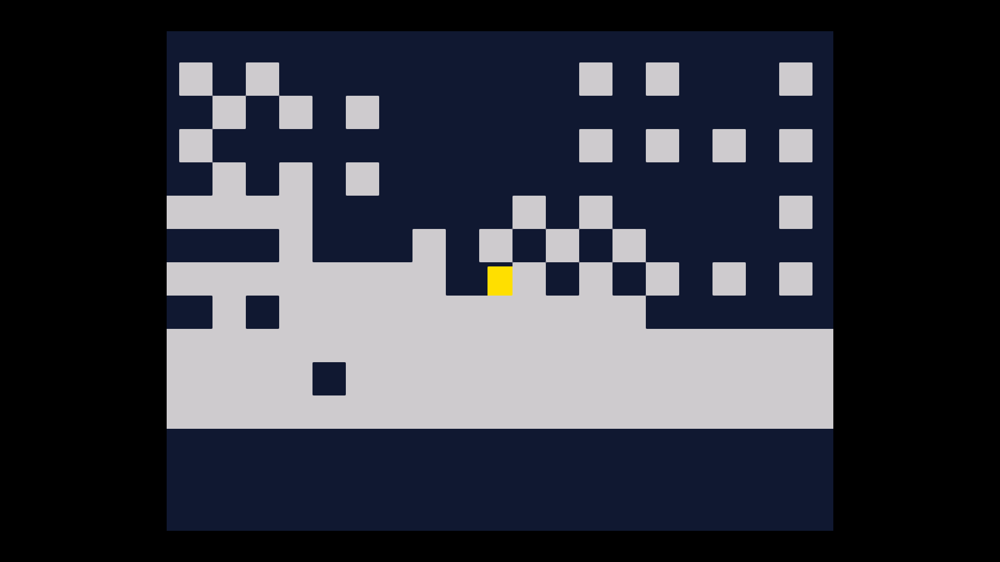
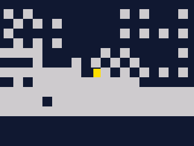
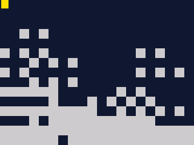

# Demo — the alpha in three minutes

This is the written form of the demo: seven commands, in the order
[`examples/demo.sh`](../examples/demo.sh) runs them, each with the output it
actually printed. The script is the thing to run; this page is what you should
see while it runs.

Two things it assumes:

- **You supply the game.** The demo reads an *unpacked* folder in the retail
  layout (`LOMAX.EXE`, `WORLDS/*.WLD`, `SFX/`, `AMBIENT/`, `JINGLES/`,
  `DEMOS/`). `<install>` below stands for the path to *your* copy; the run
  quoted here used the author's. This repository ships no game data.
- **Read-only.** Every output goes to `./demo-out` (or `--out DIR`). The CLI
  refuses to write inside a folder that holds `LOMAX.EXE`; the run quoted here
  used a folder that was mounted read-only for good measure.

## Run it

```bash
git clone https://github.com/szymon-sicinski/lomax-modern.git
cd lomax-modern
python3 -m venv .venv && . .venv/bin/activate
pip install -e .

bash examples/demo.sh "<install>"     # everything lands in ./demo-out
```

The script prints each command before it runs it, so the terminal transcript is
itself the demo, and it stops at the first failure (`set -euo pipefail`). Run
from a source checkout it uses the code in that checkout
(`python3 -m lomax_modern`) rather than an installed copy, so it works before
`pip install` too.

The seven steps below are the same commands typed by hand, with the output of
one run. The install path is written as `<install>` throughout; everything else
is verbatim. Where a block is too long for the page, the elided part is marked
and the script prints it in full.

## 1. `doctor` — what is in your copy

```console
$ lomax-modern doctor "<install>"
entry         kind   state       files       bytes  sha256
------------------------------------------------------------------------
LOMAX.EXE     file   present                505344  04cc4dfd260037ba...
GAME.TXT      file   present                 19532  4dee439e2eeb3a38...
LOMAX.HLP     file   present                 29063  38a96dda6a47a2d4...
LOMAX.CNT     file   present                   941  f1cbf61b81b067a5...
LOMAX.GID     file   present                 10847  50df138aa7033337...
WORLDS/       dir    present         9     7107048
SFX/          dir    present        67     1391846
DEMOS/        dir    present        14       65536
JINGLES/      dir    present         3      503068
AMBIENT/      dir    present        12     2480444

world files: 9 (7107048 bytes)
  BONUS.WLD               184376 bytes
  ED.WLD                  551904 bytes
  HAUNTED.WLD            1753572 bytes
  MAIN.WLD               1003820 bytes
  MAP.WLD                 138712 bytes
  MEDIEVAL.WLD           1310488 bytes
  TITLE.WLD               353848 bytes
  VILLAGE.WLD             851192 bytes
  WEST.WLD                959136 bytes

verdict: looks like a complete PC install
```

**What you are looking at:** one line per entry of *your* folder — nine world
containers totalling 7,107,048 bytes, the `LOMAX.EXE` (505,344 bytes, hashed for
inventory but never read or executed by the engine) and the audio and demo
folders — and nothing is written.

## 2. `present --modern` — one engine frame, filtered and scaled

```console
$ lomax-modern present "<install>" --world VILLAGE --modern \
    --config demo-out/config.json --frame demo-out/frame-modern.png
install: <install>

  entry        kind   state       files       bytes  note
  ...                                    (install manifest, as in step 1)
verdict: complete unpacked install (retail layout)
config: demo-out/config.json (created with modern defaults)
world: VILLAGE.WLD
engine: 300 ticks at 60 Hz (fixed by the engine core), 300 frames, exit reached: no
profile: modern (authentic toggle: off)
filter: epx-aa (runtime switch: --filter nearest|epx-aa)
source: 320x240 (engine frame)
surface: 1920x1080
scale: 4x (auto: largest integer fit)
content: 1280x960 at +320+60; pads left 320, right 320, top 60, bottom 60
frame: demo-out/frame-modern.png (1920x1080)
```

**What you are looking at:** the engine's 320×240 frame scaled by the largest
integer that fits a 1920×1080 surface — `epx-aa`, 4×, 1280×960 of content with
320 px side pads and 60 px top/bottom pads — written as a PNG, with the run's
settings recorded in a config file next to it.

## 3. `present --authentic` — the same frame, untouched

```console
$ lomax-modern present "<install>" --world VILLAGE --authentic \
    --config demo-out/config.json --frame demo-out/frame-authentic.png
install: <install>

  entry        kind   state       files       bytes  note
  ...                                    (install manifest, as in step 1)
verdict: complete unpacked install (retail layout)
config: demo-out/config.json (existing)
world: VILLAGE.WLD
engine: 300 ticks at 60 Hz (fixed by the engine core), 300 frames, exit reached: no
profile: authentic (authentic toggle: on)
filter: nearest (runtime switch: --filter nearest|epx-aa)
source: 320x240 (engine frame)
surface: 320x240
scale: 1x (auto: largest integer fit)
content: 320x240 at +0+0; pads left 0, right 0, top 0, bottom 0
frame: demo-out/frame-authentic.png (320x240)
```

**What you are looking at:** the same engine frame with the escape hatch pulled
— native 320×240, nearest-neighbour, no invented smoothing — so the only
differences from step 2 are `profile`, `filter`, `surface`, `scale` and the
output path.

### The two frames, side by side

<table>
<tr>
<td align="center"></td>
<td align="center"></td>
</tr>
<tr>
<td align="center"><code>frame-modern.png</code><br>1920×1080 · epx-aa · 4×</td>
<td align="center"><code>frame-authentic.png</code><br>320×240 · nearest · 1×</td>
</tr>
</table>

Both images are this CLI's own output, produced by the two commands above from
the author's unpacked copy — they are not screenshots of the original game.
These two frames are the *geometric* debug render (collision grid + player
marker), captured before the tile-art path shipped; `present --frame` and
`slice --frames` now compose the real tile art (map cell → `TTAB` record →
`CELL`, `HEAD` palette, index-0 transparency — see §4). So what these two
images compare is the presenter, not the art.

## 4. `slice --frames 120` — two seconds of the engine, one PNG per tick

```console
$ lomax-modern slice "<install>" --world VILLAGE --frames 120 --out demo-out/frames
world: VILLAGE (15 planes, playfield plane 0)
playfield: 305x24 cells (4880x384 px)
collision: byte 0 = passable, non-zero = solid [H]; per-value semantics (material/one-way/hazard) unresolved (Q31); the documented [D] bit-field is retracted
collision-byte histogram (value: count): 0x00:5364, 0x01:774, 0x02:2, ... 0xff:1
                                          (256 entries elided here; the script prints them all)
spawn: (0.0, 0.0) px (placeholder -- the real spawn is a GNMY entry; entry layout verified, spawn/exit/collectable semantics unverified, Q32)
collect: 0/0 (placeholder -- the real positions are GNMY entries; entry layout verified, spawn/exit/collectable semantics unverified, Q32)
result: did not reach exit after 120 ticks
frames: 120 (fixed 60 Hz: one frame per tick)
final position: (180.0, 178.0) px
next level: none (end of sequence or exit not reached)
exit: clean
tile art: composed -- map cell -> tile record resolved (Q20), each record blitted as four CELLs in 2x2 column-major order (V, G1) with the HEAD palette (slot 1) and index-0 transparency; flip pairing [H] (Q33); the geometric collision grid stays on render() as a debug path
frames: 120 PNGs in demo-out/frames (frame_0000.png .. frame_0119.png)
```

**What you are looking at:** the headless engine running a fixed 60 Hz tick —
no display, no window, no `LOMAX.EXE` — and writing one `frame_0000.png` …
`frame_0119.png` per tick, so the movement is on disk instead of in one final
still.

## 5. `gif` — the frame sequence as one looping animation

```console
$ lomax-modern gif demo-out/frames --out demo-out/demo.gif --fps 60
frames: 120, 320x240
timing: 60 fps -> 2 cs per frame, loops forever
palette: global, 3 colours
size: 184859 bytes
written: demo-out/demo.gif
```

**What you are looking at:** the 120 PNGs folded into one GIF89a with no
dependency outside the standard library — a global three-colour table, a
180 KB file that loops forever. GIF delays are whole centiseconds, so 60 fps is
written as `2 cs`: the 120 ticks play in 2.4 s instead of 2.0 s. That ceiling is
the format's, not a rounding accident.



<p align="center"><code>demo.gif</code> · 120 frames · 320×240 · loops forever</p>

## 6. `conformance` — the renderer proved against itself

```console
$ python3 -m lomax_modern.conformance
render conformance (headless, no display, no game data)
depth-bound: 15-bit -> 8-bit directly vs 15-bit -> B5G6R5 -> 8-bit max delta rgb=(0, 2, 0) (measured over 32768 words)
  PASS  depth-16-vs-24/tiles: depth 16 vs 24: 64x40 px, max delta rgb=(0, 2, 0), tolerance (0, 2, 0)
  PASS  transparency/tiles: transparency: 231 transparent px, 231 untouched, 0 occluded, key-colour leaks 16=0 24=0
  PASS  depth-16-vs-24/sprites: depth 16 vs 24: 32x24 px, max delta rgb=(0, 2, 0), tolerance (0, 2, 0)
  PASS  transparency/sprites: transparency: 63 transparent px, 63 untouched, 0 occluded, key-colour leaks 16=0 24=0
  PASS  depth-16-vs-24/palette-sweep: depth 16 vs 24: 16x16 px, max delta rgb=(0, 2, 0), tolerance (0, 2, 0)
  PASS  transparency/palette-sweep: transparency: 7 transparent px, 7 untouched, 0 occluded, key-colour leaks 16=0 24=0
  PASS  integer-scale/tiles-x3: integer scale: ideal 3.031x -> applied x3, pads (1, 1, 2, 2), 5 scroll shifts, 0 block violations
  PASS  integer-scale/palette-sweep-x2: integer scale: ideal 2.125x -> applied x2, pads (1, 1, 2, 2), 5 scroll shifts, 0 block violations
  PASS  integer-fit/320x240-in-800x600: fit: 320x240 in 800x600, ideal 2.500x -> x2 content 640x480, pads (80, 80, 60, 60) (integer only)
  PASS  integer-fit/320x240-in-1920x1080: fit: 320x240 in 1920x1080, ideal 4.500x -> x4 content 1280x960, pads (320, 320, 60, 60) (integer only)
verdict: PASS (10/10 cases)
display: not required (DISPLAY=unset)
```

**What you are looking at:** ten renderer properties checked against reference
results on synthetic fixtures — the 15-bit palette bound measured over all
32,768 words, transparency, integer scaling and integer fit — with no display
and no game data, so the number cannot be nudged by the demo's own inputs.

## 7. `export` — the world file decoded into sheets

```console
$ lomax-modern export "<install>/WORLDS/VILLAGE.WLD" --out demo-out/art
world: VILLAGE.WLD
chunks: 131 (15 planes)
palette: HEAD slot 1 of 10 (hypothesis H -- the container names no slot, Q8; non-empty slots in this HEAD: 0, 1, 3, 6, 7, 8, 9)
transparency: index 0 has alpha 0
CELL: 1374 records of 64 B = 8x8 pixels -> village_cells.png (512x688) [pixel order H: row-major]
TTAB: 10196 records of 8 B (four big-endian u16 cell indices, 13-bit index) -- record-level count only, not map-referenced tiles
TTAB flags preserved verbatim: 0x2000 on 2434 words, 0x4000 on 1130 words, 0x8000 on 0 words (meaning unresolved, Q21)
TTAB out-of-bank indices: none (CELL bank holds 1374 records, Q22)
plane 00: 305x24 cells = 7320, 1024 TTAB records, MAP pad 0 B -> village_tiles_plane00.png, village_map_plane00_collision.png
plane 01: 304x28 cells = 8512, 1042 TTAB records, MAP pad 0 B -> village_tiles_plane01.png, village_map_plane01_collision.png
...                       (one line per plane, 00 to 14; the script prints them all)
plane 14: 24x16 cells = 384, 2 TTAB records, MAP pad 0 B -> village_tiles_plane14.png, village_map_plane14_collision.png
tile sheet layout: strip (stored order, four cells per record; the order inside a record is column-major [V], G1)
MAP: 60509 cells (2 B tile word + 1 B collision byte, split: N words then N bytes), 636 distinct tile words; map sheet shows the raw collision byte as greyscale, no art
map cell -> tile record: resolved -- map word is a direct TTAB record index (Q20); 0 of 60509 map words fall outside their plane's TTAB range
distinct TTAB records referenced via MAP: 636 of 5098
sprite frames: not exported (sprite-frame export is not implemented; the ANIM record layout is verified -- docs/file-formats.md 2.6)
```

**What you are looking at:** 31 PNGs written from one 851,192-byte world file —
a cell sheet, a tile sheet and a collision map per plane — with every field that
is still not certain named as one (`Q8` palette slot; `Q21`'s flip *pairing*,
which is `Q33`) instead of being guessed into the picture. `Q20` (map cell →
tile record) and `Q24` (sprite frames) are **answered** — the exporter reports
0 of 60,509 map words outside their plane's `TTAB` range, and says plainly that
sprite export is unimplemented rather than that the layout is unknown.

## When the path is wrong

The script fails at the first command that refuses the folder, not halfway
through a run. Pointed at a directory that is not an install:

```console
$ bash examples/demo.sh /tmp/not-an-install
== 1/7  doctor -- what is in your copy (read-only) ==
$ python3 -m lomax_modern doctor /tmp/not-an-install
...                                         (every entry reported MISSING)
verdict: incomplete install, missing: LOMAX.EXE, GAME.TXT, WORLDS/*.WLD

== 2/7  present --modern -- one engine frame, epx-aa, 4x into 1920x1080 ==
$ python3 -m lomax_modern present /tmp/not-an-install ...
verdict: not an unpacked Lomax game directory -- missing: WORLDS/, LOMAX.EXE
error: not an unpacked Lomax game directory: /tmp/not-an-install
```

`present` exits 2 and the script stops there with no `demo-out` directory at
all, because the install gate runs before the config or the frame is written.

## What this demo is not

Plainly: **there is no window, no input, no audio and no music.** You are
watching a data layer, a headless engine and a presenter that writes PNG and
GIF; the frame advances because the engine ticks, not because anyone is
playing, and nothing is listening to the keyboard. Audio and input are the
M5/M6 milestones, and the installed data carries no music track at all — the
presenter is silent and will stay silent until the audio layer exists. This is
also not a shipped game, not a patched executable, and not a fork of any other
project: it reads your unpacked copy, writes its own output, and stops.
